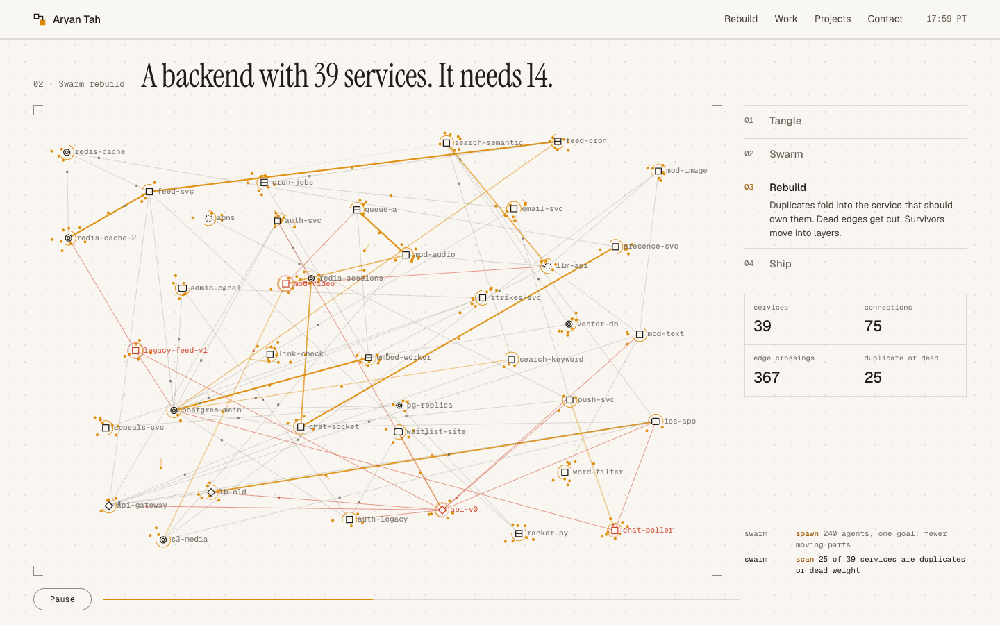

# Aryan Tah · portfolio

My personal site. I'm a backend engineer and co-founder of [Vennbee](https://vennbee.com), where I own search, feed, moderation and real-time chat.

**Live:** [aryan-tah.github.io/portfolio](https://aryan-tah.github.io/portfolio/)



Most portfolio sites tell you someone is good at systems. I wanted this one to show it, so the centerpiece is a diagram that rebuilds itself while you watch. It's built from scratch in TypeScript and Canvas 2D, with no framework and about 15 KB of gzipped JavaScript.

## What's on the page

**Request trace.** The hero shows a waterfall of spans, the way Jaeger or Honeycomb would draw one, cycling through four Vennbee request paths: a feed read, a hybrid search, a video upload going through moderation, and a chat message fanning out. The timings are illustrative, and the page says so.

**Swarm rebuild.** One screen. Once the diagram is fully in view, a 6.5-second rebuild plays on its own. It starts as a deliberately tangled v0 backend: 39 services, two search services the client has to merge itself, four copies of the moderation service, a polling fallback nobody turned off. A swarm of agents, drawn as multiplayer cursors, flies in and drags each service where it belongs: duplicates into the service that should own them, survivors into a layered design with 14 services. Connections that matter stretch along with the drag and turn into clean edges; the rest get cut the moment their service is picked up. Then traffic starts moving. The traffic keeps flowing after the rebuild ends, and a button pauses or replays it. Hover any node to see what was wrong with it or what it does now.


The four numbers next to the diagram (services, connections, edge crossings, duplicates) are counted from the drawing on every frame. They are not typed in. The clean layout's layer order came from a brute-force search over every ordering for the fewest crossings, which got it from 9 down to 3.

**Hybrid search toy.** Three example queries and a slider that blends keyword scoring with semantic scoring, `α · semantic + (1 − α) · keyword`, which is the same shape Vennbee's search uses. Keyword scores are computed live from the text. Semantic scores are precomputed stand-ins, and the page says that too.

## Run it

Needs Node 20 or newer.

```bash
npm install
npm run dev       # http://localhost:5173
npm run build     # type-checks, then writes dist/
npm run preview   # serves dist/
```

## How it's put together

```
index.html            page structure and all static copy
src/
  content.ts          experience, projects, education, stack (edit this first)
  main.ts             renders sections, runs the swarm's playback loop
  trace.ts            hero trace waterfall
  search.ts           hybrid search toy
  styles.css          tokens, layout, every component
  swarm/
    graph.ts          both architectures, merge notes, crossing counter
    scene.ts          canvas renderer and the rebuild timeline
public/
  favicon.svg
  og.png              social preview, captured from the live swarm
```

A few decisions worth knowing about:

- **The swarm is a pure function of progress.** Every node position, edge cut and agent path is computed from progress `p` between 0 and 1, plus a separate clock for ambient motion like orbiting agents and packets. Playback just advances `p`, which is why pause and replay need no extra state, and why traffic keeps moving once `p` reaches 1.
- **It starts when you can see all of it.** A second `IntersectionObserver` watches the diagram, offset by the sticky nav, and only advances the rebuild while at least 97% of it is in frame. Scroll away mid-rebuild and it waits for you.
- **Each messy node names its fate.** In `graph.ts`, a node with `into: "search"` folds into the clean `search` node, and a node whose `into` is its own id survives and moves to its layered position. Merging nodes chase their target's current position, so the two move together.
- **The canvas only runs while it's on screen.** An `IntersectionObserver` starts and stops the `requestAnimationFrame` loop. Device pixel ratio is capped at 2.
- **Wide screens lay the clean design out left to right; phones lay it out top to bottom.** The same graph, with labels moved under the nodes.
- **Colors live in CSS.** The palette is defined in OKLCH on `:root` and redefined for dark mode. The canvas reads the same custom properties, so the diagram follows the system theme.

## Accessibility

- Respects `prefers-reduced-motion`: ambient motion, packets and CSS transitions turn off, and the swarm doesn't autoplay. It waits for the Play button.
- Every interactive control is a real `button` or `input` and works from the keyboard. The query chips behave as a radio group with arrow keys.
- Visible focus rings, a skip link, and hover effects limited to devices that can actually hover.

## Make it yours

Fork it, then:

1. Replace the copy in `src/content.ts` and the hero and contact text in `index.html`.
2. Redraw the two architectures in `src/swarm/graph.ts`. The section's heading updates itself from the node counts.
3. Change `--accent` in `src/styles.css`. It's the only saturated color on the page.
4. Update the `og:image` URL in `index.html` and the source link in the footer.

## Deploy

Pushing to `main` builds the site and publishes it to GitHub Pages through `.github/workflows/deploy.yml`. Vite's `base` is `./`, so the build works at a project URL or on a custom domain without changes.

## License

The code is MIT licensed; see [LICENSE](LICENSE). The written content about me (work history, project descriptions) is mine, so please swap in your own if you reuse the site.
